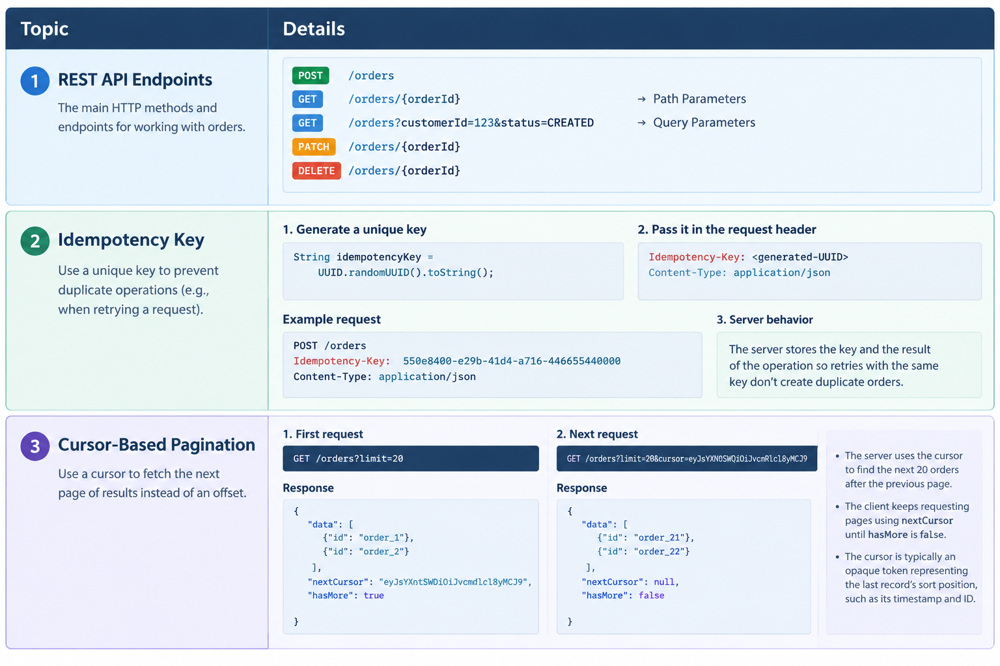
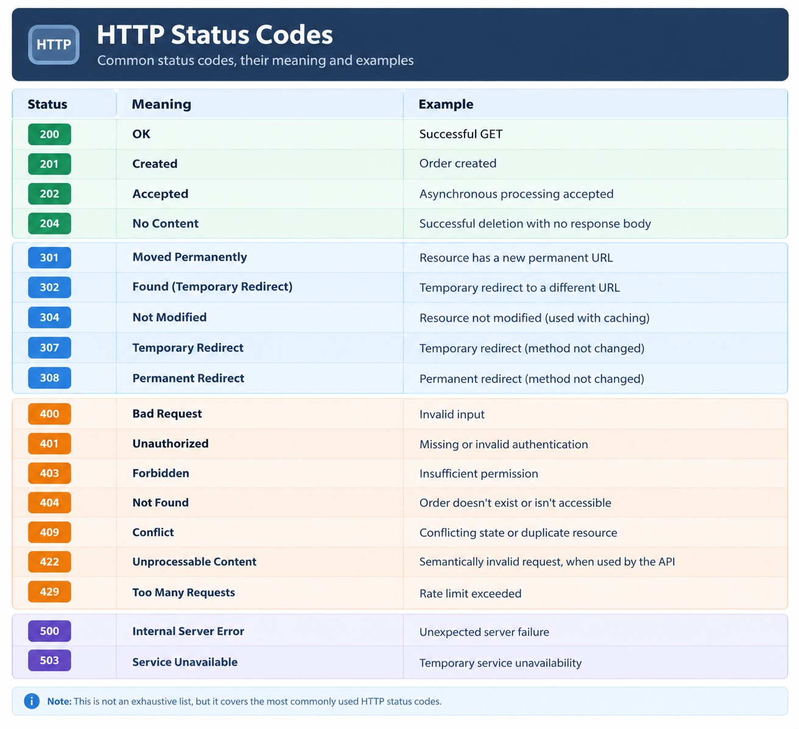
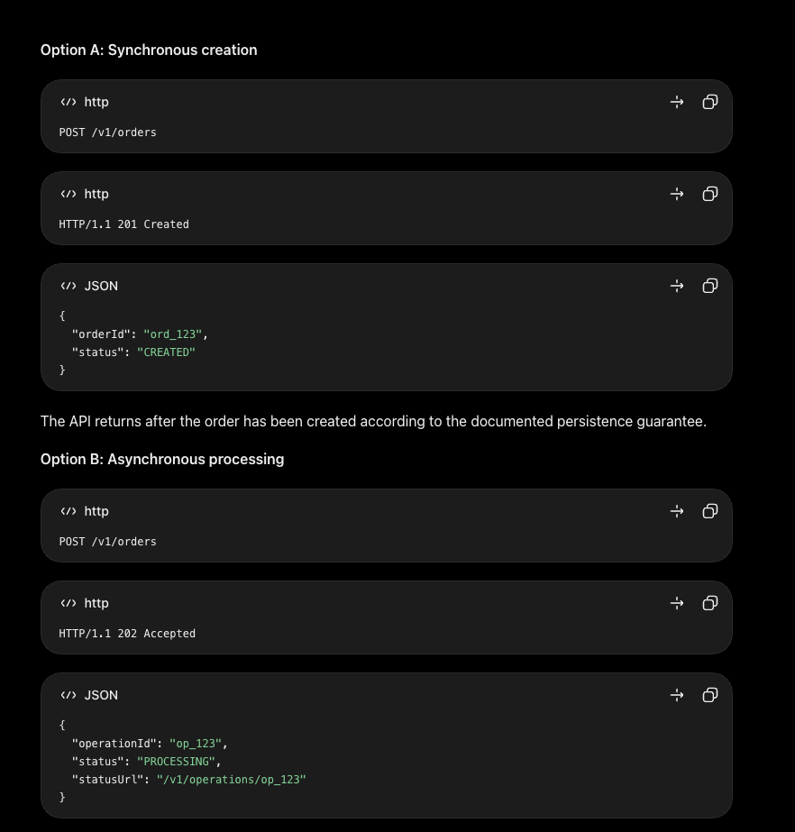

### REST







### WebSocket	

wss://api.example.com/ws

```text
Remember: ws:// is for an unencrypted WebSocket connection, while wss:// is for a secure connection. In production, you generally use wss://.
```

### GRPC

1. Define the service contract (methods and request/response messages) in a .proto file.
2. Generate client/server code from the .proto file and use the generated client stub to make the gRPC call.

Usually, both client and server the same .proto contract through a shared repository or package.

