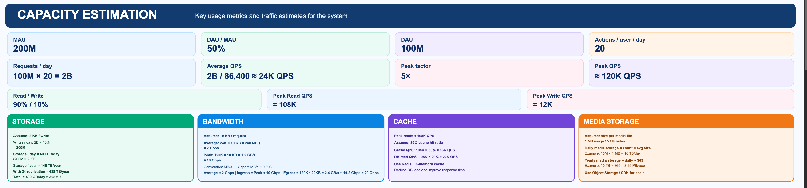

System Design: Add question here

1. Identify the Functional Requirements (FR) – prioritize the 4–6 most important requirements.
2. Identify the Non-Functional Requirements (NFR) – cover latency, availability, scalability, consistency, security, durability, idempotency and observability, wherever relevant.

Show me the capacity estimation
