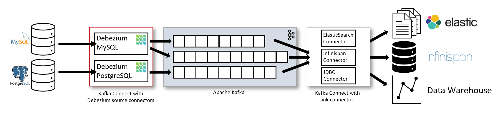
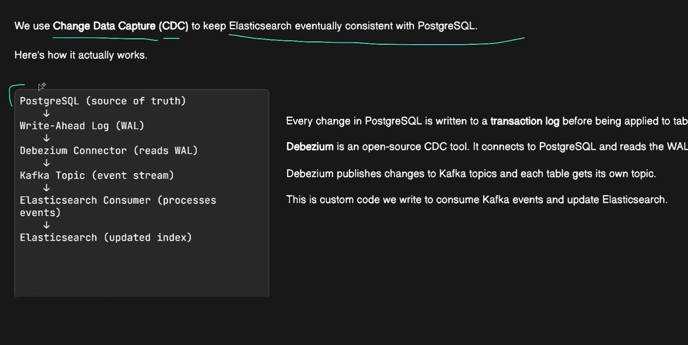

Most commonly, you deploy Debezium by means of Apache Kafka Connect. Kafka Connect is a framework and runtime for implementing and operating:
1. Source connectors such as Debezium that send records into Kafka
2. Sink connectors that propagate records from Kafka topics to other systems

As shown in the image, the Debezium connectors for MySQL and PostgresSQL are deployed to capture changes to these two types of databases. Each Debezium connector establishes a connection to its source database:

The MySQL connector uses a client library for accessing the binlog.

The PostgreSQL connector reads from a logical replication stream.

Kafka Connect operates as a separate service besides the Kafka broker.

By default, changes from one database table are written to a Kafka topic whose name corresponds to the table name. If needed, you can adjust the destination topic name by configuring Debezium’s topic routing transformation. For example, you can:

Route records to a topic whose name is different from the table’s name

Stream change event records for multiple tables into a single topic

