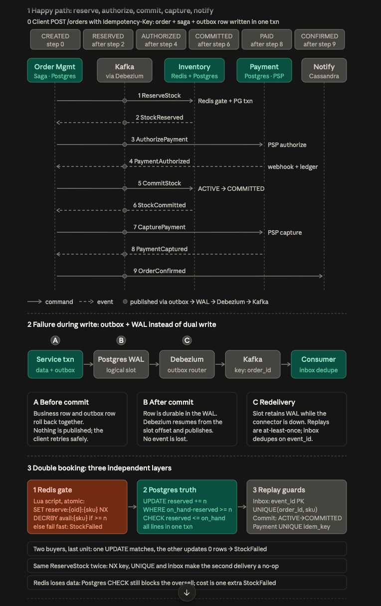
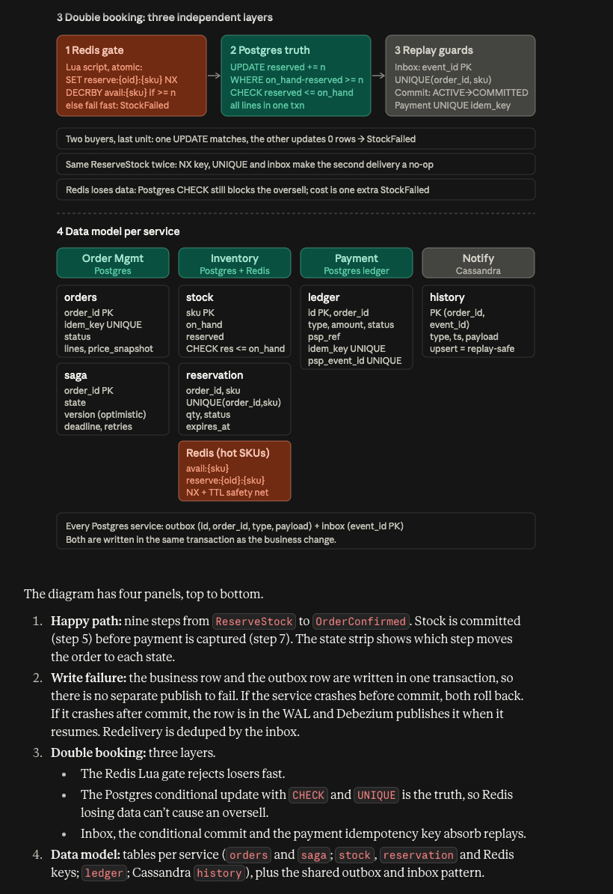
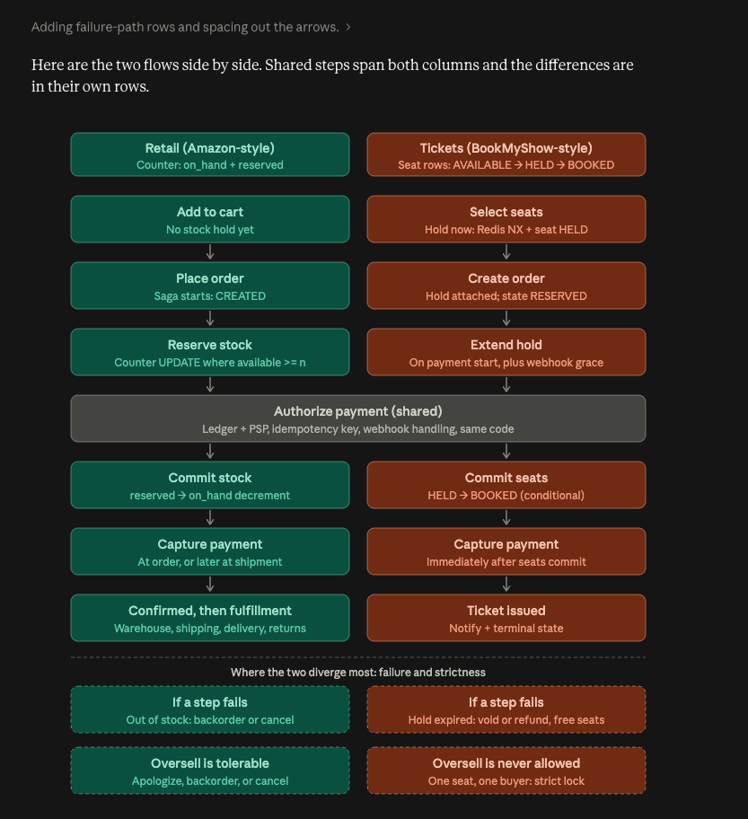

# Outbox Pattern — Order Management System

## 1. Problem

Suppose we create an order and also need to publish an `OrderCreated` event to Kafka.

A naive approach could be:

```text
Order Service
    |
    +--> Save Order to PostgreSQL
    |
    +--> Publish OrderCreated to Kafka
```

The problem is that these are **two independent operations**.

For example:

```text
Save Order to DB
       ↓
Application crashes
       ↓
Kafka event NOT published
```

Now the order exists in the database, but downstream services never receive the event.

---

# 2. Outbox Pattern

The Outbox Pattern solves this by storing the event in the **same database transaction** as the business data.

```text
                    Order Service
                         |
                         | BEGIN TRANSACTION
                         ↓
                +-------------------+
                |   PostgreSQL      |
                |                   |
                | orders table      |
                |       +           |
                | outbox table      |
                +-------------------+
                         |
                         | COMMIT
                         ↓
                        WAL
                         ↓
                        CDC
                         ↓
                       Kafka
                         ↓
                    Consumers
```

---

# 3. Transaction

When an order is created, we perform two operations in the **same transaction**.

```sql
BEGIN;

INSERT INTO orders
(order_id, customer_id, status)
VALUES
(123, 456, 'CREATED');

INSERT INTO outbox
(event_id, aggregate_id, event_type, payload)
VALUES
(101, 123, 'OrderCreated', '{...}');

COMMIT;
```

The important point is:

> **The Order DB update and Outbox entry are part of the same database transaction.**

Therefore, either both succeed or both fail.

```text
Transaction

orders table
     |
     +---- INSERT Order
     |
outbox table
     |
     +---- INSERT OrderCreated event
     
     ↓
   COMMIT
```

If the transaction fails:

```text
orders      → NOT committed
outbox      → NOT committed
```

If the transaction succeeds:

```text
orders      → committed
```






