DataStorage - WAL -> MemTable -> SSTable(SortedString Table) -> Compaction (Merge SSTable) -> Bloom Filter -> ConsistentHashing -> Quoram (Strong R+W>N vs Eventual Consistency R=1, W=1) 
Conflict Resolution (VectorClocks), Gossip Protocol, Merkle Tree

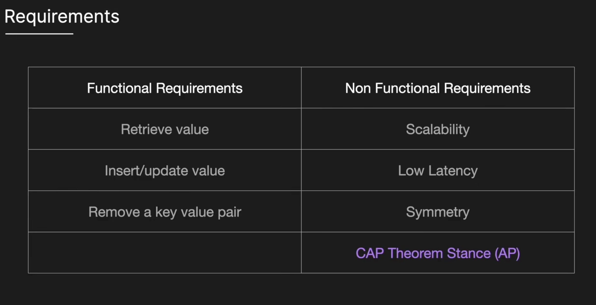
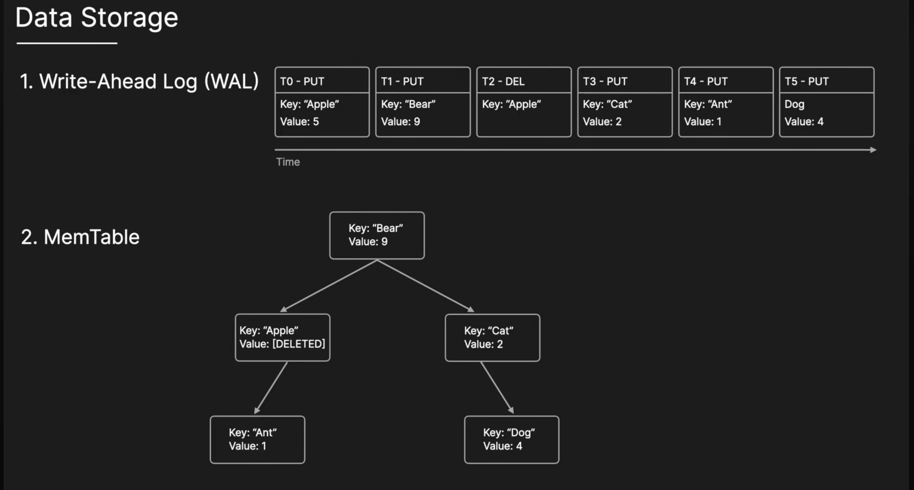
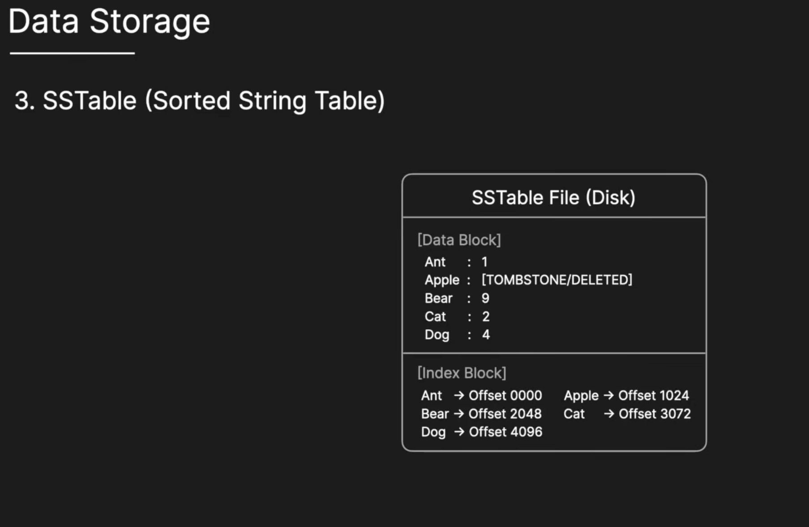
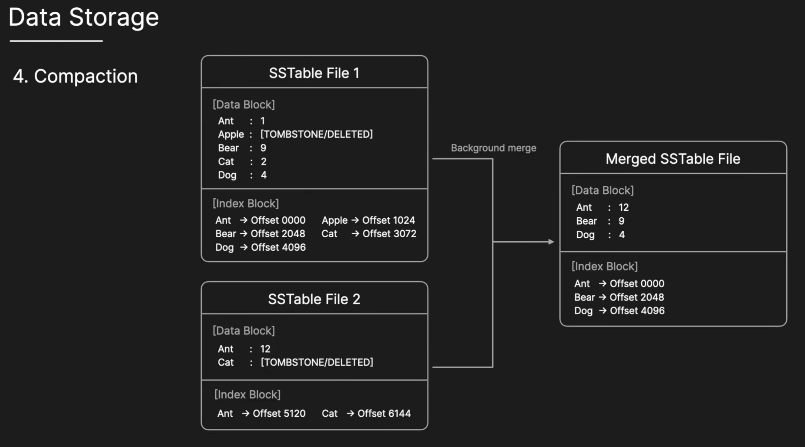
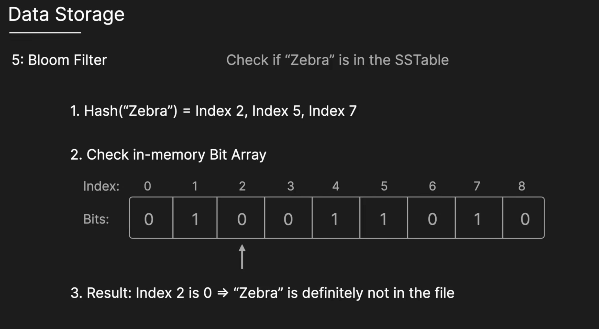
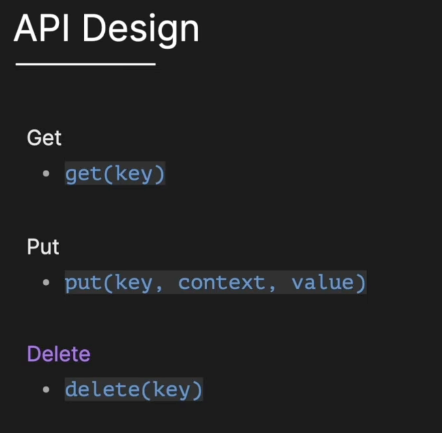
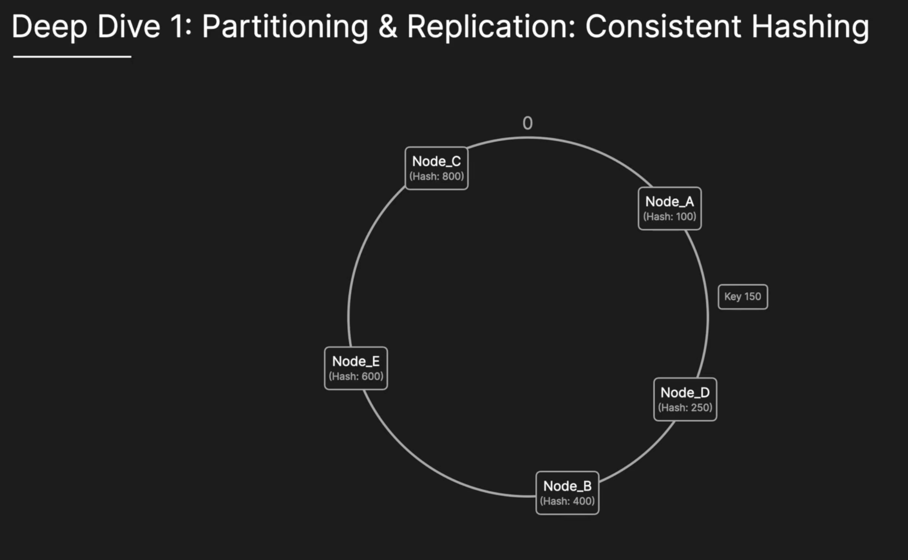
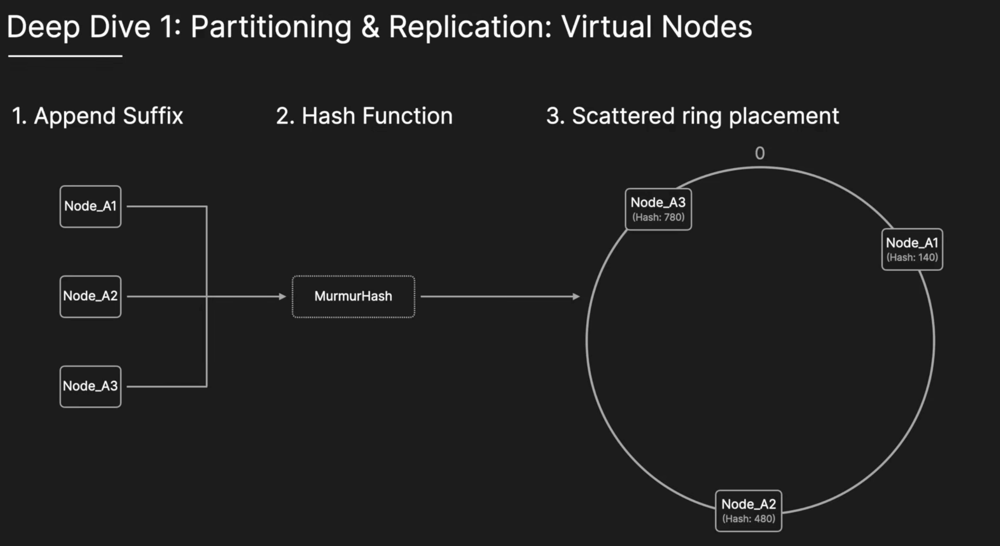
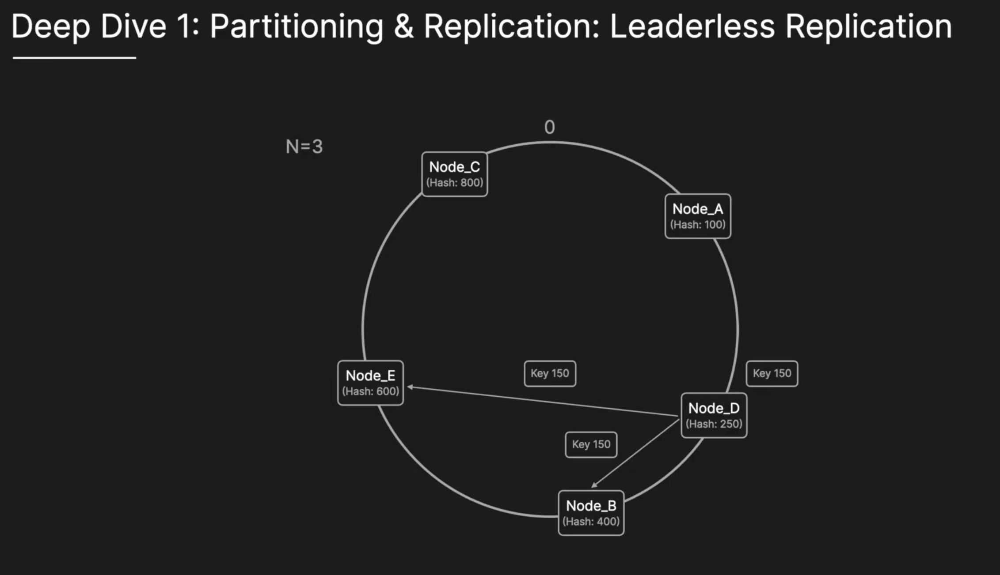
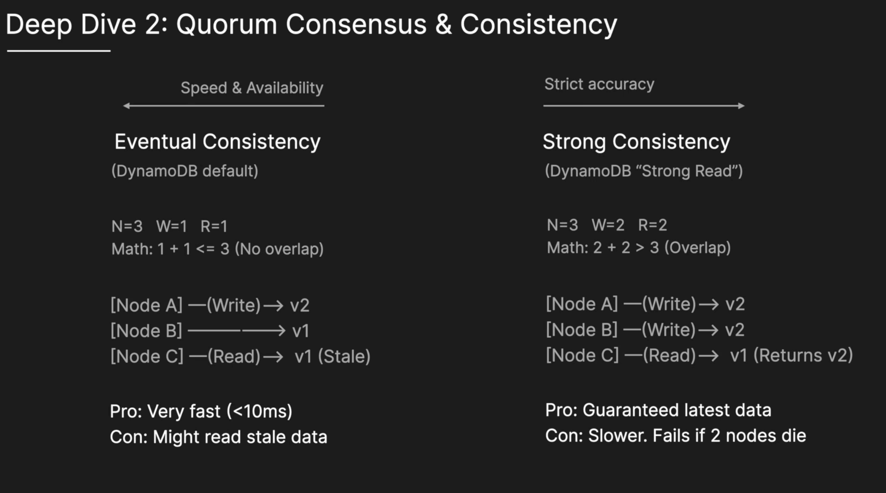
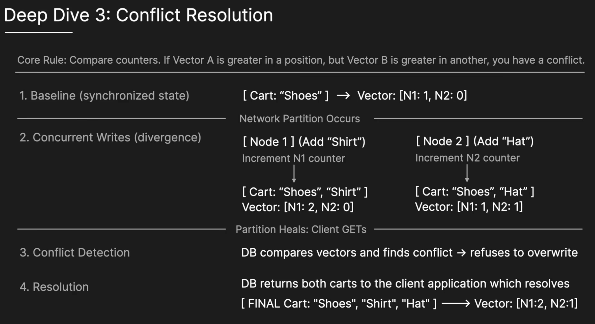
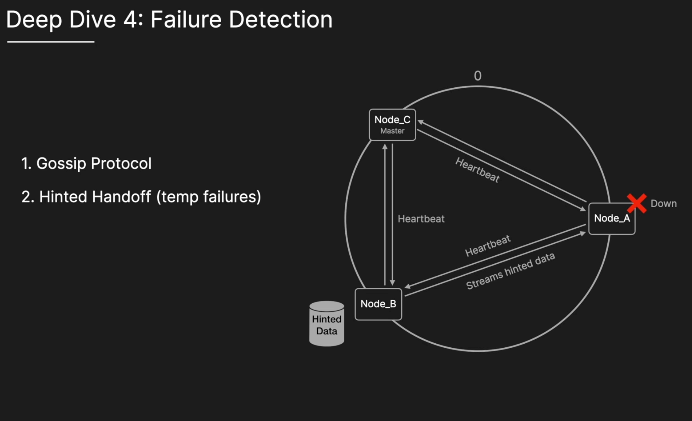
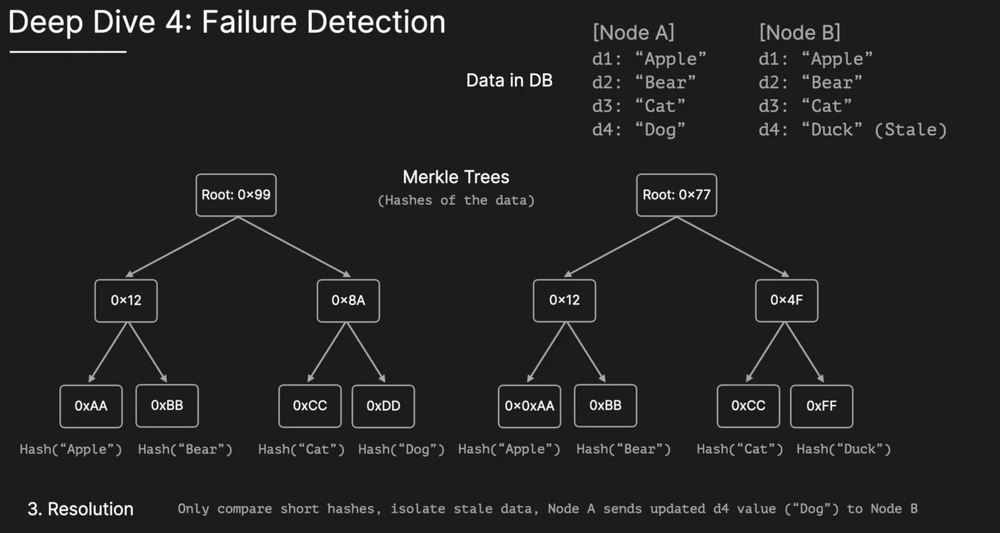
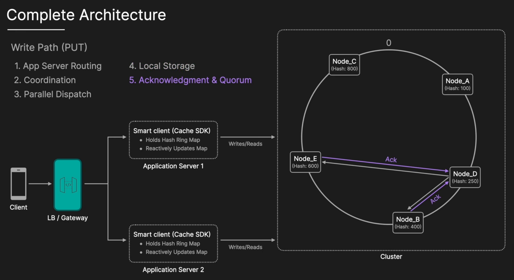
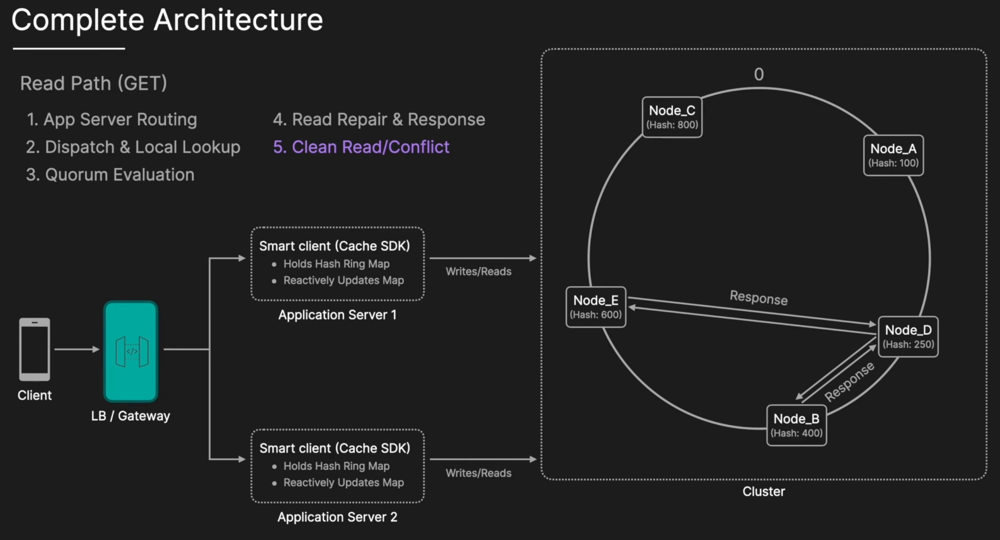