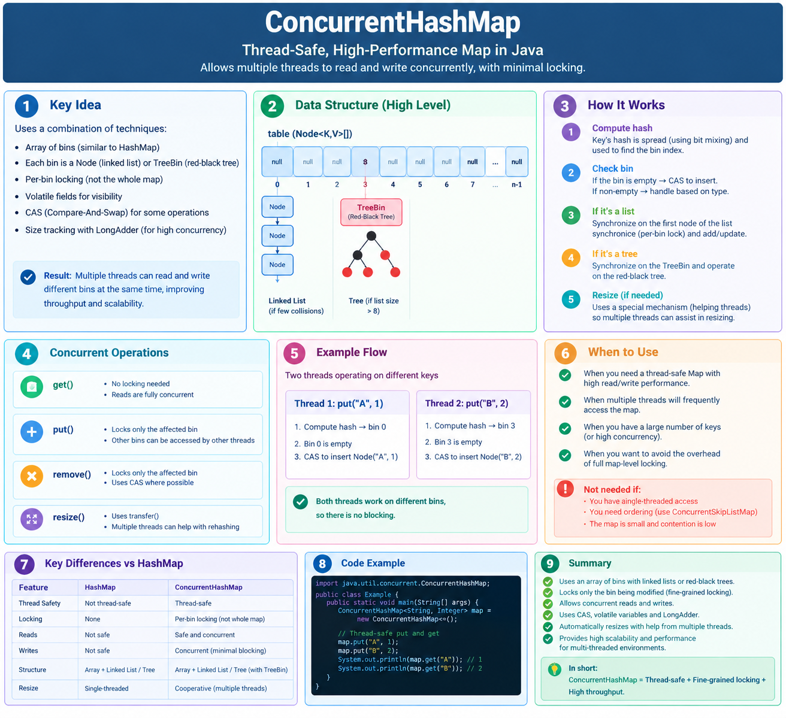
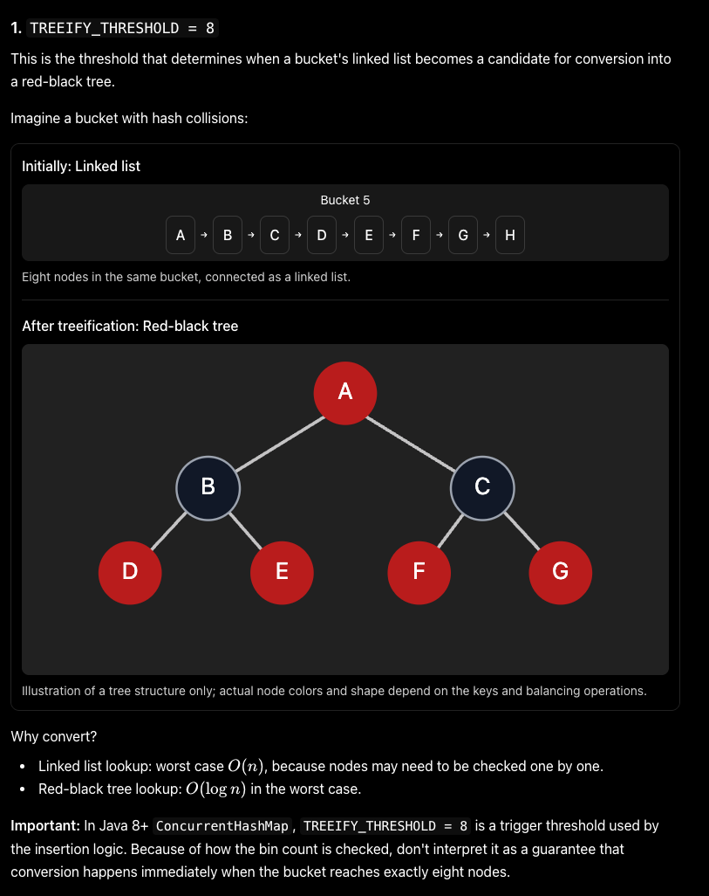
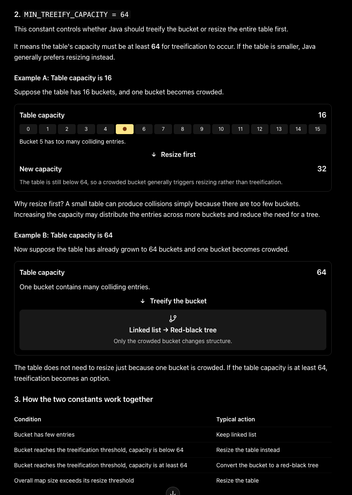

## ConcurrentHashMap


# ConcurrentHashMap — Put, Get, CAS, Treeification and Resizing (Java 8+)

## 1. What is CAS?

**CAS (Compare-And-Swap)** atomically updates a value only if its current value matches the expected value.

Example: `CAS(null, newNode)` inserts a node only if the bucket is still empty.

## 2. How `put(key, value)` works

1. **Calculate hash** → identify the bucket.
2. **Bucket empty** → use CAS to insert the first node without locking.
3. **Bucket non-empty** → use `synchronized` on the bin's first node.
4. **Search the bin:**

    * Key exists → update its value.
    * Key doesn't exist → append a new node to the linked list.
5. **Treeification check** → if the bin is too crowded, consider converting it into a red-black tree.
6. **Resizing check** → if the table's size threshold is exceeded, expand the table.

## 3. How collisions form a linked list

Different keys can map to the same bucket.

```text
Bucket 5
   |
   v
[Apple:100] → [Mango:75] → [Orange:50] → null
```

When inserting into this bucket, ConcurrentHashMap traverses the list to find an existing key or append a new node.

## 4. Linked List → Red-Black Tree

When a bucket contains too many nodes, ConcurrentHashMap may convert its linked list into a red-black tree.

```text
Before: Linked List

[A] → [B] → [C] → [D] → [E] → [F] → [G] → [H]


After: Red-Black Tree (illustrative)

             [D]
            /   \
          [B]   [F]
          / \   / \
        [A] [C][E] [G]
```

### Treeification rules

* `TREEIFY_THRESHOLD = 8`
* `MIN_TREEIFY_CAPACITY = 64`
* When inserting into a crowded bin, treeification is considered around the 8-node threshold.
* If the table capacity is below 64, ConcurrentHashMap generally resizes instead of treeifying.
* A red-black tree improves lookup from **O(n)** to approximately **O(log n)** for a collision-heavy bin.

## 5. How `get(key)` works

1. Calculate the key's hash and locate the bucket.
2. Check the first node; return its value if the key matches.
3. Otherwise:

    * **Linked-list bin:** traverse the nodes.
    * **Tree bin:** search the red-black tree.
4. Return the value, or `null` if the key is absent.

A normal `get()` does not acquire a bin lock.

## 6. When and how does remapping/resizing happen?

**Resizing** means expanding the internal bucket array when the map's size exceeds its threshold.

1. The table has a capacity, commonly a power of two.
2. Its resize threshold is approximately `capacity × load factor` (default load factor: `0.75`).
3. When adding entries pushes the size beyond that threshold, ConcurrentHashMap initiates or participates in resizing.
4. The table typically doubles in capacity.
5. Existing nodes are redistributed into the new table based on their hashes.
6. Multiple threads can help transfer buckets during resizing.

**Example:**

```text
Capacity = 16
Threshold ≈ 16 × 0.75 = 12

When the map grows beyond the threshold:
Capacity: 16 → 32
New threshold ≈ 32 × 0.75 = 24
```

Resizing is separate from treeification: a crowded individual bin may trigger treeification or a resize, while exceeding the table-wide threshold triggers resizing.

> **Terminology:** “Remapping” can also mean the `compute()`, `computeIfAbsent()`, `computeIfPresent()`, and `merge()` methods, which recompute or conditionally update a key's value. These are different from resizing. Some remapping operations execute a user-supplied function under bin-level synchronization, so keep the function short and avoid recursive map updates.

## 7. Interview summary

| Operation / concept | Key point                                                              |
| ------------------- | ---------------------------------------------------------------------- |
| `put()`             | CAS for an empty bin; fine-grained synchronization for a non-empty bin |
| `get()`             | Normally reads without acquiring a lock                                |
| Collision handling  | Multiple entries can share one bucket in a linked list                 |
| Treeification       | A crowded bin may become a red-black tree                              |
| Resizing            | Table capacity grows when the size threshold is exceeded               |
| CAS                 | Atomic conditional update                                              |
| Remapping methods   | Recompute or conditionally update a key's value                        |

**Remember:** ConcurrentHashMap combines CAS, fine-grained locking, lock-free-style reads, treeification, and concurrent resizing. It does not lock the entire map for every operation.




